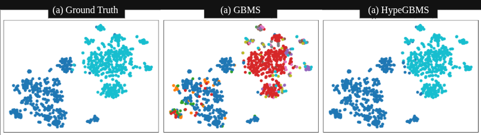

# Hyperbolic Gaussian-Based Mean Shift (HypeGBMS)

Implementation of the HypeGBMS clustering algorithm on the Poincaré ball model.


## Requirements
- torch
- numpy
- scikit-learn
- scipy

## Example Dataset
You can run the algorithm on any tabular dataset.  
For quick testing, you can use scikit-learn datasets (e.g. `load_iris` or `load_wine`).

| Dataset      | Samples | Dimensions | Classes |
|-------------|---------|-----------|---------|
| Phishing    | 235795    | 54        | 2       |
| Zoo         | 101     | 16        | 7       |
| Wine        | 178     | 13        | 3       |
| Wisconsin B.C.        | 699     | 9         | 2       |
| Iris        | 150     | 4         | 3       |
| Pendigits   | 10992   | 16        | 10      |
| MNIST       | 60000   | 784       | 10      |
| ORHD        | 5620    | 64        | 10      |
| Ecoli       | 336     | 7         | 8       |
| ORL face        | 400     | 4096      | 40      |
| Glass       | 214     | 9         | 7       |


## Installation & Running
### Installing
Clone the repository and install dependencies:

```bash
git clone https://github.com/arnab37seal/HypeGBMS.git
cd HypeGBMS
pip install -r requirements.txt
pip install -e .

